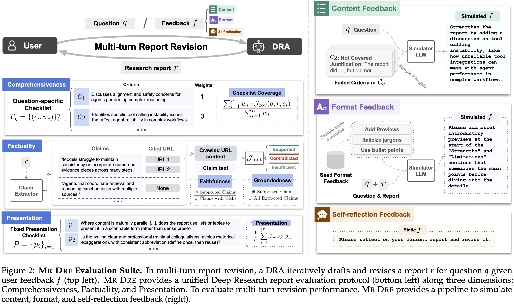

# Mr Dre: Evaluation Suite for Deep Research Report Writing and Multi-turn Revision

<p align="center">
    <a href="https://www.arxiv.org/abs/2601.13217" target="_blank" rel="noopener noreferrer">
        
    </a>
    &nbsp;&nbsp;
    <a href="https://x.com/BaleCcchen/status/2015792860440793228" target="_blank" rel="noopener noreferrer">
        
    </a>
</p>

Official repository for the paper [*"Beyond Single-shot Writing: Deep Research Agents are Unreliable at Multi-turn Report Revision"*](https://www.arxiv.org/abs/2601.13217).

Human researchers rarely write a report in a single shot, as we iteratively draft and revise from peer feedback or self-reflection. Can Deep Research Agents also reliably revise their reports in response to user feedback? We introduce **Mr Dre**, a new evaluation suite for Deep Research Agents (DRAs) on *multi-turn report writing and revision*. Specifically, Mr Dre includes:

1. **A Unified Evaluation Protocol for Deep Research Reports:** We consolidated best practices from previous Deep Research evaluation works into a lean protocol spanning three dimensions: *Comprehensiveness*, *Factuality*, and *Presentation*.
2. **Feedback Simulation Pipeline for Multi-turn Report Revision:** To evaluate not only the single-shot writing capabilities of Deep Research Agents but also their multi-turn report revision ability, we introduce a reliable method to simulate content, format, and self-reflection feedback.



## Table of Contents

- [News](#news)
- [Setup](#setup)
- [Data](#data)
- [Evaluate Your Own DRA](#evaluate-your-own-dra)
- [DRA Report Generation](#dra-report-generation)
- [DRA Report Evaluation](#dra-report-evaluation)
- [Release Progress](#release-progress)
- [Contact Us](#contact-us)
- [Citation](#citation)

## News
[10/2026] 🏆 Our paper was accepted to ACL 2026 and received a **SAC Highlight Award**!

[10/2026] Evaluating your own DRA is now plug-and-play: see [Evaluate Your Own DRA](#evaluate-your-own-dra).

[01/20/2026] Initial Code Release🎉

## Setup

We recommend using [uv](https://github.com/astral-sh/uv) to quickly set up and manage your environment:

```shell
# Clone the repository
git clone https://github.com/BaleChen/Mr-Dre.git
cd Mr-Dre

# Set up the environment
uv sync

# Activate the virtual environment
source .venv/bin/activate
```


Then, set your API keys as environment variables by defining them in `.env`. You can use our provided `.env.example` as a reference. Evaluation only requires `OPENAI_API_KEY` (LLM judges) and `JINA_API_KEY` (crawling cited webpages). Generating reports with the built-in DRAs additionally requires `PERPLEXITY_API_KEY` and `SERPER_API_KEY`. Serving open-weight DRAs locally needs vLLM, which you can install with `uv sync --extra serve`.

> **Note:** Tongyi Deep Research, DR Tulu, and Open Deep Research require customized environment setup. We recommend isolating the server-side and client-side environments for best compatibility. See [`engine/README.md`](engine/README.md) for detailed instructions on setting up each DRA engine's server.

## Data

We provide the three datasets used in our experiments in the `./data` folder:

- [ResearchRubrics](https://scale.com/research/researchrubrics): `ResearchRubrics.jsonl`
- [RigorousBench](https://github.com/evigbyen/rigorousbench): `RigorousBench.jsonl`
- [ResearcherBench](https://github.com/GAIR-NLP/ResearcherBench): `ResearcherBench.jsonl`

These JSONL files are preprocessed into a standardized format compatible with the report writing, revision, and evaluation pipelines in this repository.

<details>
<summary>Dataset Sample Format</summary>

```
{
    "id": (int | str) Question ID,
    "question": (str) Question text,
    "checklist": (List[Dict]) [
        {
            "id": (int) Checklist item ID,
            "item": (str) Checklist item text,
            "weight": (int) Checklist item weight score
        }
    ],
    "metadata": (Dict) { ... metadata from different datasets }
}
```

</details>

To bring your own dataset, ensure the questions have annotated *question-specific checklists* for report comprehensiveness evaluation. Process your dataset into a JSONL file following the format above and name it `YOUR_DATASET_NAME.jsonl`.

## Evaluate Your Own DRA

All evaluation goes through one command. Save your agent's reports as JSONL with one `{"id": ..., "report": "..."}` object per line, where `id` matches the dataset and cited sources appear as URLs in the report text, then run:

```bash
python mrdre.py evaluate --dataset ResearcherBench --reports my_dra_turn1.jsonl --output_dir results/my-dra
```

This scores Comprehensiveness, Factuality, and Presentation, prints a summary table, and writes `summary.json` and CSV tables to `results/my-dra/`. The run is resumable, so re-running the same command retries only the reports that have not been evaluated.

To evaluate **multi-turn revision**, let Mr Dre simulate the user feedback, run your agent on the exported conversations, and evaluate both turns together:

```bash
# Simulate feedback for turn 2 (content_feedback, format_feedback, or reflection)
python mrdre.py feedback --dataset ResearcherBench --output_dir results/my-dra --turn 1 --type content_feedback

# Run your agent on each record's "messages" in results/my-dra/feedback_turn2.jsonl and save my_dra_turn2.jsonl

# Evaluate both turns and the revision metrics (Incorporation Rate, Break Rate, and score deltas)
python mrdre.py evaluate --dataset ResearcherBench --reports my_dra_turn1.jsonl my_dra_turn2.jsonl --output_dir results/my-dra
```

Alternatively, wrap your agent as an engine by implementing a single `generate(messages)` method, and the generation scripts below will run all turns for you. [`docs/evaluate_your_dra.md`](docs/evaluate_your_dra.md) describes both options, the report format, the outputs, and the metrics in detail.

## DRA Report Generation

Use `generate_report.sh` to generate reports with supported DRAs. This script supports multi-turn report generation or revision with different feedback types.

### Notes
- The first turn is always generated with type `init`.
- Generating turn *n* requires that turns 1 to *n-1* have already been generated.
- Before applying `content_feedback` type to turn *n*, the model output for turn *n-1* must be evaluated (at least the checklist mode evaluation is done, since feedback generation relies on failed checklist criteria).

### Basic Usage

Use the provided shell script for easier execution:

```bash
./scripts/generate_report.sh <dataset> <model> <turn> <type>
```

### Key Parameters
The `generate_report.sh` script accepts the following parameters:
- `<dataset>`: Dataset name (`ResearcherBench`, `RigorousBench`, `ResearchRubrics`) [required]
- `<model>`: Model name (`dr-tulu`, `o4-mini-deep-research`, `o4-gpt4.1`, `sonar-deep-research`, `tongyi-deep-research`) [required]
- `<turn>`: Turn number (starting from 1) [default: 1]
- `<type>`: Turn type (`init`, `reflection`, `content_feedback`, `format_feedback`) [default: init]

## DRA Report Evaluation

We recommend `mrdre.py evaluate` (see [Evaluate Your Own DRA](#evaluate-your-own-dra)), which also accepts the output folders of `generate_report.sh` directly:

```bash
python mrdre.py evaluate --dataset ResearcherBench --run_dir output/ResearcherBench/init/o4-mini-deep-research
```

The lower-level `evaluate_report.sh` evaluates a single report file. It supports three evaluation modes: checklist, citation, and rubric. Note that the three modes correspond to our three evaluation dimensions defined in our paper: Comprehensiveness is measured by *checklist* coverage; Factuality uses *citation*-based metrics (citation faithfulness and claim groundedness); Presentation score relies on a fixed set of *rubrics* to evaluate.

### Basic Usage

Use the provided shell script for easier execution:

```bash
./scripts/evaluate_report.sh <report_file> <dataset_file> (<eval_mode> <num_questions>)
```

### Key Parameters
The `evaluate_report.sh` script accepts the following parameters:
- `<report_file>`: Path to generated report JSONL file [required]
- `<dataset_file>`: Path to dataset JSONL file [required]
- `<eval_mode>`: Optional. Evaluation mode (`all`, `checklist`, `citation`, `rubric`) [default: all]
- `<num_questions>`: Optional. Number of questions to evaluate (-1 for all) [default: -1]

Similarly, `python evaluate_change.py <gen_turn{i}.jsonl> <gen_turn{j}.jsonl> [--formal-change]` computes the revision metrics between two evaluated turns; `mrdre.py evaluate` does this automatically for consecutive turns.

## Release Progress

- [x] Main evaluation protocol
- [x] Setup quickstart
- [x] Main engine and generation code
- [x] Feedback simulation
- [x] Datasets used in our paper
- [x] Shell scripts for easy generation/evaluation
- [x] "How to Evaluate External DR Reports?" guide ([docs/evaluate_your_dra.md](docs/evaluate_your_dra.md))
- [ ] Tongyi, DR Tulu, Open Deep Research server-side code
- [x] "How to Add a New DRA Engine" guide ([docs/evaluate_your_dra.md](docs/evaluate_your_dra.md#option-b-wrap-your-agent-as-an-engine))

## Contact Us

If you have any questions, feel free to email me at `bale[dot]chen[at]nyu[dot]edu`. If you encounter any issues, you can also open an issue on this repository. Please include your setup details and a code snippet to reproduce the problem so we can help resolve it quickly!

## Citation

If you find our work useful, please cite us:

```bibtex
@misc{chen2026singleshotwritingdeepresearch,
      title={Beyond Single-shot Writing: Deep Research Agents are Unreliable at Multi-turn Report Revision}, 
      author={Bingsen Chen and Boyan Li and Ping Nie and Yuyu Zhang and Xi Ye and Chen Zhao},
      year={2026},
      eprint={2601.13217},
      archivePrefix={arXiv},
      primaryClass={cs.CL},
      url={https://arxiv.org/abs/2601.13217}, 
}
```

<details>
<summary>Mr Dre builds upon several existing DRA benchmarks and evaluation frameworks, please consider citing them as well:</summary>

This is a non-exhausive list. Please see the reference section of our paper for more information.
```bibtex
@misc{sharma2025researchrubrics,
      title={ResearchRubrics: A Benchmark of Prompts and Rubrics For Evaluating Deep Research Agents}, 
      author={Manasi Sharma and Chen Bo Calvin Zhang and Chaithanya Bandi and Clinton Wang and Ankit Aich and Huy Nghiem and Tahseen Rabbani and Ye Htet and Brian Jang and Sumana Basu and Aishwarya Balwani and Denis Peskoff and Marcos Ayestaran and Sean M. Hendryx and Brad Kenstler and Bing Liu},
      year={2025},
      eprint={2511.07685},
      archivePrefix={arXiv},
      primaryClass={cs.AI},
      url={https://arxiv.org/abs/2511.07685}, 
}

@misc{yao2025rigorousbench,
      title={A Rigorous Benchmark with Multidimensional Evaluation for Deep Research Agents: From Answers to Reports}, 
      author={Yang Yao and Yixu Wang and Yuxuan Zhang and Yi Lu and Tianle Gu and Lingyu Li and Dingyi Zhao and Keming Wu and Haozhe Wang and Ping Nie and Yan Teng and Yingchun Wang},
      year={2025},
      eprint={2510.02190},
      archivePrefix={arXiv},
      primaryClass={cs.AI},
      url={https://arxiv.org/abs/2510.02190}, 
}

@misc{xu2025researcherbench,
      title={ResearcherBench: Evaluating Deep AI Research Systems on the Frontiers of Scientific Inquiry}, 
      author={Tianze Xu and Pengrui Lu and Lyumanshan Ye and Xiangkun Hu and Pengfei Liu},
      year={2025},
      eprint={2507.16280},
      archivePrefix={arXiv},
      primaryClass={cs.AI},
      url={https://arxiv.org/abs/2507.16280}, 
}

@misc{wang2025liveresearchbench,
      title={LiveResearchBench: A Live Benchmark for User-Centric Deep Research in the Wild}, 
      author={Jiayu Wang and Yifei Ming and Riya Dulepet and Qinglin Chen and Austin Xu and Zixuan Ke and Frederic Sala and Aws Albarghouthi and Caiming Xiong and Shafiq Joty},
      year={2025},
      eprint={2510.14240},
      archivePrefix={arXiv},
      primaryClass={cs.AI},
      url={https://arxiv.org/abs/2510.14240}, 
}

@misc{fan2025understandingdeepresearchreports,
      title={Understanding DeepResearch via Reports}, 
      author={Tianyu Fan and Xinyao Niu and Yuxiang Zheng and Fengji Zhang and Chengen Huang and Bei Chen and Junyang Lin and Chao Huang},
      year={2025},
      eprint={2510.07861},
      archivePrefix={arXiv},
      primaryClass={cs.AI},
      url={https://arxiv.org/abs/2510.07861}, 
}
```

</details>
