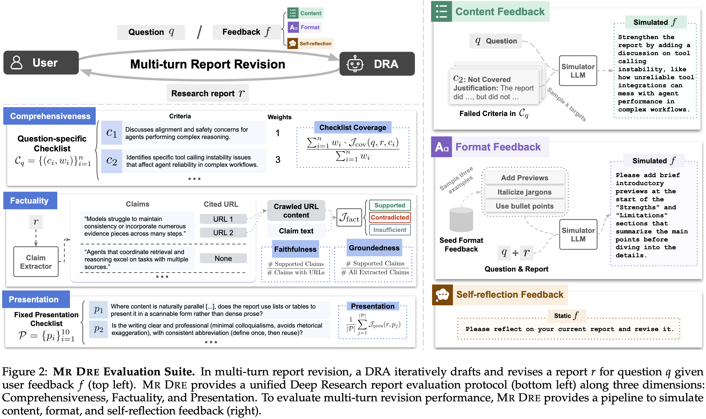

# Mr Dre: Evaluation Suite for Deep Research Report Writing and Multi-turn Revision

<p align="center">
    <a href="https://www.arxiv.org/abs/2601.13217" target="_blank" rel="noopener noreferrer">
        
    </a>
    &nbsp;&nbsp;
    <a href="https://x.com/BaleCcchen/status/2015792860440793228" target="_blank" rel="noopener noreferrer">
        
    </a>
</p>

Official repository for the paper [*"Beyond Single-shot Writing: Deep Research Agents are Unreliable at Multi-turn Report Revision"*](https://www.arxiv.org/abs/2601.13217).

Human researchers rarely write a report in a single shot, as we iteratively draft and revise from peer feedback or self-reflection. Can Deep Research Agents also reliably revise their reports in response to user feedback? We introduce **Mr Dre**, a new evaluation suite for Deep Research Agents (DRAs) on *multi-turn report writing and revision*. Specifically, Mr Dre includes:

1. **A Unified Evaluation Protocol for Deep Research Reports:** We consolidated best practices from previous Deep Research evaluation works into a lean protocol spanning three dimensions: *Comprehensiveness*, *Factuality*, and *Presentation*.
2. **Feedback Simulation Pipeline for Multi-turn Report Revision:** To evaluate not only the single-shot writing capabilities of Deep Research Agents but also their multi-turn report revision ability, we introduce a reliable method to simulate content, format, and self-reflection feedback.



## Table of Contents

- [News](#news)
- [Setup](#setup)
- [Data](#data)
- [Quick Start](#quick-start)
- [Contact Us](#contact-us)
- [Citation](#citation)

## News
[11/2026] 🛠️ We released the `mrdre` command-line tool: one command each for generating reports, simulating feedback, and evaluating reports and revisions. See the [Quick Start](#quick-start) and [CLI-guide.md](CLI-guide.md).

[07/2026] 🏆 Our paper was accepted to ACL 2026 and received a **SAC Highlight Award**!

[01/20/2026] Initial Code Release🎉

## Setup

Clone the repository and install it with [uv](https://github.com/astral-sh/uv):

```shell
git clone https://github.com/BaleChen/Mr-Dre.git
cd Mr-Dre
uv sync --python 3.12
source .venv/bin/activate
```

Then define your API keys in a `.env` file in the directory where you run `mrdre`, using `.env.example` as a template:

| Key | Needed for |
| --- | --- |
| `OPENAI_API_KEY` | Evaluation judges, feedback simulation, and the OpenAI Deep Research engines |
| `JINA_API_KEY` | Fetching webpage content from a URL |
| `PERPLEXITY_API_KEY` | The Sonar Deep Research engine |
| `SERPER_API_KEY` | Web search tool |

OpenAI calls of the judges and of feedback simulation, and fetched web pages, are cached on disk for 30 days in `.cache/` at the root of the clone (set `MCP_CACHE_DIR` to use another folder), so rerunning an evaluation does not repeat these calls.

## Data

We provide the three datasets used in our experiments in the `./data` folder:

- [ResearchRubrics](https://scale.com/research/researchrubrics): `ResearchRubrics.jsonl`
- [RigorousBench](https://github.com/evigbyen/rigorousbench): `RigorousBench.jsonl` (now called Dr. Bench)
- [ResearcherBench](https://github.com/GAIR-NLP/ResearcherBench): `ResearcherBench.jsonl`

These JSONL files are preprocessed into a unified data format.

<details>
<summary>Dataset Sample Format</summary>

```
{
    "id": (int | str) Question ID,
    "question": (str) Question text,
    "checklist": (List[Dict]) [
        {
            "id": (int) Checklist item ID,
            "item": (str) Checklist item text,
            "weight": (int) Checklist item weight score
        }
    ],
    "metadata": (Dict) { ... metadata from different datasets }
}
```

</details>

To bring your own dataset, have each question annotated with a *question-specific checklist* for the comprehensiveness evaluation, write the questions to a JSONL file in the format above, and pass its path to `--dataset` in the `mrdre` CLI below.

> [!NOTE]
> The latest version of our paper calls the question-specific checklist a *rubric*, in line with the literature; the two terms mean the same thing. The code and data keep the name `checklist`; the `rubric` evaluation mode below is the separate set of presentation rubrics.

## Quick Start

Mr Dre has three main functions: evaluating reports, simulating user feedback, and generating or revising reports. Each is an `mrdre` command that reads and writes plain JSONL files with one record per question, so any stage can be replaced by your own code.

| Command | What it does |
| --- | --- |
| `mrdre evaluate` | Scores a file of reports; given the previous turn's evaluation and the feedback, also scores the revision |
| `mrdre feedback` | Simulates one feedback message per report: content, format, or self-reflection |
| `mrdre generate` | Generates or revises reports with a supported engine or your own Python function |

One round of writing and revision on ResearcherBench:

```bash
# 1. Write the first turn of reports (or write runs/turn1.jsonl with your own agent)
mrdre generate \
    --dataset researcherbench \
    --engine o4-mini-deep-research \
    --out runs/turn1.jsonl

# 2. Score the reports
mrdre evaluate \
    --dataset researcherbench \
    --reports runs/turn1.jsonl \
    --out runs/eval_turn1

# 3. Simulate content feedback on the reports (uses the checklist scores from step 2)
mrdre feedback \
    --dataset researcherbench \
    --reports runs/turn1.jsonl \
    --feedback-type content \
    --eval runs/eval_turn1 \
    --out runs/feedback_turn2.jsonl

# 4. Revise the reports according to the feedback
mrdre generate \
    --dataset researcherbench \
    --engine o4-mini-deep-research \
    --previous runs/turn1.jsonl \
    --feedback runs/feedback_turn2.jsonl \
    --out runs/turn2.jsonl

# 5. Score the revised reports, and the revision against the scores from step 2
mrdre evaluate \
    --dataset researcherbench \
    --reports runs/turn2.jsonl \
    --previous-eval runs/eval_turn1 \
    --feedback runs/feedback_turn2.jsonl \
    --out runs/eval_turn2
```

For a third turn, repeat steps 3 to 5 on the second-turn reports and pass all earlier turns to `--previous`, oldest first.

See [CLI-guide.md](CLI-guide.md) for every command and option, including evaluating reports from your own agent, plugging in your own agent, and the revision metrics.

## Contact Us

If you have any questions, feel free to email me at `bale[dot]chen[at]nyu[dot]edu`. If you encounter any issues, you can also open an issue on this repository. Please include your setup details and a code snippet to reproduce the problem so we can help resolve it quickly!

## Citation

If you find our work useful, please cite the published version of our paper:

```bibtex
@inproceedings{chen-etal-2026-beyond-single,
    title = "Beyond Single-shot Writing: Deep Research Agents are Unreliable at Multi-turn Report Revision",
    author = "Chen, Bingsen and Li, Boyan and Nie, Ping and Zhang, Yuyu and Ye, Xi and Zhao, Chen",
    booktitle = "Proceedings of the 64th Annual Meeting of the {A}ssociation for {C}omputational {L}inguistics (Volume 1: Long Papers)",
    year = "2026",
    publisher = "Association for Computational Linguistics",
    url = "https://aclanthology.org/2026.acl-long.609/",
    pages = "13325--13356"
}
```

<details>
<summary>Mr Dre builds upon several existing DRA benchmarks and evaluation frameworks, please consider citing them as well:</summary>

This is a non-exhausive list. Please see the reference section of our paper for more information.
```bibtex
@misc{sharma2025researchrubrics,
      title={ResearchRubrics: A Benchmark of Prompts and Rubrics For Evaluating Deep Research Agents}, 
      author={Manasi Sharma and Chen Bo Calvin Zhang and Chaithanya Bandi and Clinton Wang and Ankit Aich and Huy Nghiem and Tahseen Rabbani and Ye Htet and Brian Jang and Sumana Basu and Aishwarya Balwani and Denis Peskoff and Marcos Ayestaran and Sean M. Hendryx and Brad Kenstler and Bing Liu},
      year={2025},
      eprint={2511.07685},
      archivePrefix={arXiv},
      primaryClass={cs.AI},
      url={https://arxiv.org/abs/2511.07685}, 
}

@misc{yao2025rigorousbench,
      title={A Rigorous Benchmark with Multidimensional Evaluation for Deep Research Agents: From Answers to Reports}, 
      author={Yang Yao and Yixu Wang and Yuxuan Zhang and Yi Lu and Tianle Gu and Lingyu Li and Dingyi Zhao and Keming Wu and Haozhe Wang and Ping Nie and Yan Teng and Yingchun Wang},
      year={2025},
      eprint={2510.02190},
      archivePrefix={arXiv},
      primaryClass={cs.AI},
      url={https://arxiv.org/abs/2510.02190}, 
}

@misc{xu2025researcherbench,
      title={ResearcherBench: Evaluating Deep AI Research Systems on the Frontiers of Scientific Inquiry}, 
      author={Tianze Xu and Pengrui Lu and Lyumanshan Ye and Xiangkun Hu and Pengfei Liu},
      year={2025},
      eprint={2507.16280},
      archivePrefix={arXiv},
      primaryClass={cs.AI},
      url={https://arxiv.org/abs/2507.16280}, 
}

@misc{wang2025liveresearchbench,
      title={LiveResearchBench: A Live Benchmark for User-Centric Deep Research in the Wild}, 
      author={Jiayu Wang and Yifei Ming and Riya Dulepet and Qinglin Chen and Austin Xu and Zixuan Ke and Frederic Sala and Aws Albarghouthi and Caiming Xiong and Shafiq Joty},
      year={2025},
      eprint={2510.14240},
      archivePrefix={arXiv},
      primaryClass={cs.AI},
      url={https://arxiv.org/abs/2510.14240}, 
}

@misc{fan2025understandingdeepresearchreports,
      title={Understanding DeepResearch via Reports}, 
      author={Tianyu Fan and Xinyao Niu and Yuxiang Zheng and Fengji Zhang and Chengen Huang and Bei Chen and Junyang Lin and Chao Huang},
      year={2025},
      eprint={2510.07861},
      archivePrefix={arXiv},
      primaryClass={cs.AI},
      url={https://arxiv.org/abs/2510.07861}, 
}
```

</details>
